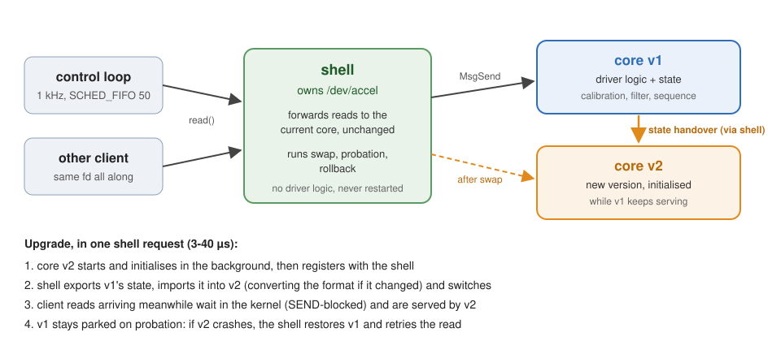
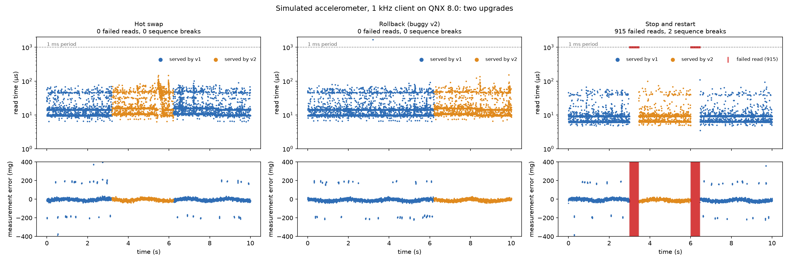
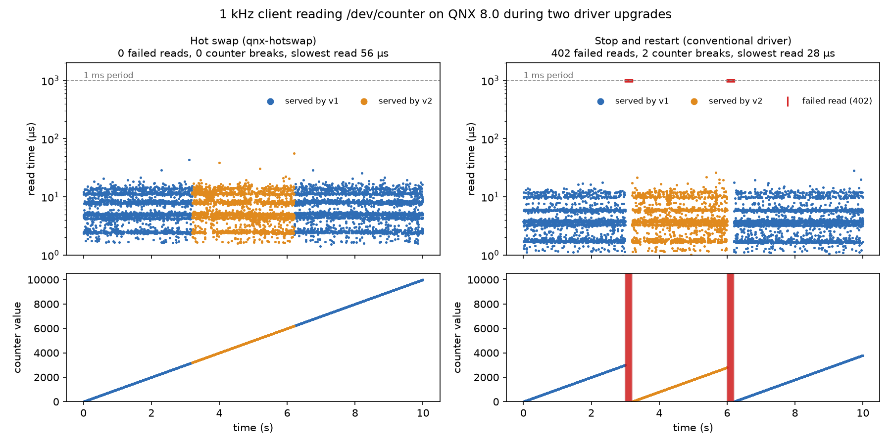
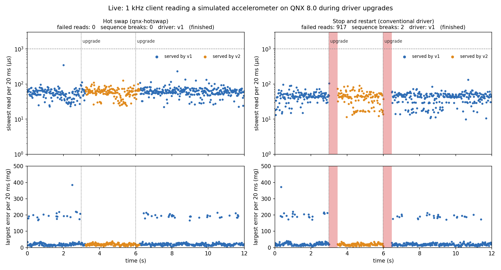

# qnx-hotswap

Upgrade a running QNX driver without its clients noticing.

On QNX, drivers are ordinary user-space processes (resource managers) that
clients talk to through message passing. `qnx-hotswap` uses that to replace a
driver with a new version while a real-time client keeps using it:

- a small, stable **shell** process owns the path (for example `/dev/accel`)
  and the channel that clients connect to;
- a swappable **core** process holds the driver logic and its state;
- on upgrade the shell holds incoming requests, the old core hands its state
  to the new one (converting between state formats if the layout changed),
  the shell switches over, and the old core is kept on probation so a crash
  of the new version rolls back automatically.

Clients keep the same file descriptor the whole time. A 1 kHz control loop
sees **no failed reads, no lost state and no missed deadlines** during the
swap; the same driver restarted the conventional way loses 700 ms of samples
and its calibration on every upgrade.





> Status: working prototype for the QNX Global Hackathon (2026).

## Code layout

| File | Role |
|---|---|
| `src/shell.c` | the stable resource manager: owns the path, forwards reads, runs swaps, probation and rollback. Knows nothing about the driver. |
| `src/core_main.c` | host process for a swappable core: registers with the shell, serves its requests through the driver callbacks |
| `src/mono_main.c` | host for the same driver as a conventional single-process resource manager (the restart baseline) |
| `src/driver.h` | what a driver implements: `import_state`, `export_state`, `read` and its state formats |
| `src/accel.c`, `src/accel.h` | accelerometer driver with simulated hardware: calibration, moving-average filter, v2 adds glitch rejection |
| `src/counter.c`, `src/counter.h` | minimal counter driver |
| `src/accel_client.c`, `src/client.c` | 1 kHz test clients for the two drivers |
| `scripts/demo-swap.sh` | runs one scenario on the target (`swap`, `rollback`, `restart`, controls) |
| `tools/plot.py` | draws the figures from the clients' per-tick CSV files |

Each driver is built from one source file into swappable cores
(`accel_v1`, `accel_v2`, `accel_v2_bad`) and conventional drivers
(`accel_mono_v1`, `accel_mono_v2`), so comparisons run identical driver code.

## Building and running the demo

```sh
source ~/qnx800/qnxsdp-env.sh
make deploy                 # builds into build/, copies to qnxvm:/tmp/hotswap

# on the target, as root:
cd /tmp/hotswap
DRV=accel INIT_MS=200 ./demo-swap.sh 10 swap       # hot swap v1 -> v2 -> v1
DRV=accel INIT_MS=200 ./demo-swap.sh 10 rollback   # buggy v2 crashes, rolls back
DRV=accel INIT_MS=200 ./demo-swap.sh 10 restart    # conventional restart
```

## Requirements

- QNX SDP 8.0 (`qcc`), tested with 8.0.5 on WSL2 Ubuntu 24.04
- A QNX 8.0 x86_64 target. This repo uses the SDP QEMU quickstart image.

## Running the QNX VM

QEMU inside WSL2 has no hardware acceleration when Windows virtualization-based
security is on, and software emulation makes timing numbers meaningless. So the
VM runs in QEMU for Windows with the Windows Hypervisor Platform (WHPX):

```powershell
winget install SoftwareFreedomConservancy.QEMU
powershell -ExecutionPolicy Bypass -File scripts\run-qemu-win.ps1 start   # stop | status | log
```

The script expects `ifs.bin` and `disk-qemu.qcow2` in `D:\qnx-vm` (`-VmDir` to
change). The qcow2 is made once from the quickstart image:

```sh
qemu-img convert -p -O qcow2 ~/qnx-qemu/qemu/output/disk-qemu disk-qemu.qcow2
```

Guest SSH is forwarded to `127.0.0.1:2223`. With `networkingMode=mirrored` in
`%USERPROFILE%\.wslconfig`, WSL reaches it at the same address.

`scripts/run-qemu.sh` boots the same image inside WSL/Linux (KVM if available,
otherwise emulation), with SSH on port 2222.

## Building and running the timing example

```sh
source ~/qnx800/qnxsdp-env.sh
cd examples/jitter
qcc -Vgcc_ntox86_64 -O2 -Wall -o jitter jitter.c
ssh qnxvm 'cat > /tmp/jitter && chmod +x /tmp/jitter' < jitter
ssh qnxvm '/tmp/jitter 5000 1000 50 timer'
```

(`scp` hangs against this image, so files are copied over `ssh` with `cat`.)

## Timing baseline

`examples/jitter` runs a 1 kHz periodic loop for 5000 iterations and measures
how late each wakeup is (QNX 8.0 guest, WHPX, AMD Ryzen 7 4800H):

| Loop | avg late | max late | missed deadlines |
|---|---|---|---|
| periodic timer + pulse, priority 50 | 11.8 µs | 121 µs | 0 |
| `clock_nanosleep`, absolute deadline | 722 µs | 890 µs | 0 |

`clock_nanosleep` is late by roughly one clock tick (1 ms) by design: QNX rounds
sleeps up to the tick. Periodic work should use a timer that delivers a pulse.

WHPX must keep the interrupt controller in the hypervisor
(`kernel-irqchip=on`, the script's default). With `kernel-irqchip=off` the
guest loses timer interrupts and the 1 kHz timer runs at about 450 Hz.

## First swap results

`scripts/demo-swap.sh 30 swap` runs the 1 kHz client (priority 50) for 30 s
while core v2 replaces v1 at 3 s and v1 replaces v2 at 6 s. `none` is the
same run without swaps. VM: 2 vCPUs, QEMU at Windows priority High.

| Run | swap time | read errors | counter gaps | missed deadlines | max late |
|---|---|---|---|---|---|
| none #1 | - | 0 | 0 | 0 | 101 µs |
| swap #1 | 8.2 / 8.5 µs | 0 | 0 | 0 | 190 µs |
| none #2 | - | 0 | 0 | 0 | 155 µs |
| swap #2 | 2.1 / 7.6 µs | 0 | 0 | 0 | 380 µs |

### State format changes and rollback

Core v2 stores more state than v1 (format 2 adds a `generation` field). A new
core registers the state formats it can read; the shell asks the old core for
a format the new one understands, and the new core converts older formats.
The same mechanism handles downgrades (v2 writes format 1 for v1).

After a swap the old core stays parked for a probation period (2 s by
default, `shell -t ms`). If the new core fails meanwhile, the shell restores
the old core from its own state snapshot and retries the failed request
there. `demo-swap.sh 10 rollback` swaps in `counter_v2_bad`, which crashes on
its first read:

```
shell: swapped v1 -> v2 (pid 2129954), value=2999, ... switch took 8.6 us
core v2 (pid 2129954): simulated bug, crashing
shell: ROLLBACK: core v2 (pid 2129954) failed (No such process); v1 (pid 2105376) restored at value 2999 in 1.6 us
shell: swapped v1 -> v2 (pid 2146338), value=6000, ... switch took 21.5 us
TOTAL reads=10000 errors=0 gaps=0 missed=0 read_us avg=6.7 max=273.1  late_max_us=174.3  core=v2
```

The client sees no error, no counter gap and no missed deadline: the read
that hit the crash took 273 µs instead of ~7 µs. Limitation: whatever the
failed core changed before crashing is lost; the old core resumes from the
handover snapshot.

### Hot swap vs. stop-and-restart



`restart` mode runs the same counter as a conventional single-process
resource manager (`counter_mono_vN`) and upgrades it the usual way, by stopping the
old process and starting the new one (what a QNX HAM restart action does).
The client reopens the device when its descriptor goes bad, as a robust
application would. Both designs get the same simulated hardware
initialisation time (`INIT_MS=200`), 10 s at 1 kHz, two upgrades:

| | hot swap (`swap`) | stop-and-restart (`restart`) |
|---|---|---|
| failed reads | **0** | 402 (201 per upgrade) |
| longest outage | **0 ms** | 201 ms |
| counter state | kept (3200 → 3201) | **lost** (2999 → 1) |
| client code needed | none | reopen on `EBADF` |
| switch time | 10-33 µs | - |

With `INIT_MS=0` the restart outage is about 1 ms (1 failed read per
upgrade), but the state is still lost and the client still sees `EBADF`.
With hot swap the new version initialises while the old one keeps serving,
so initialisation time never becomes downtime.

To reproduce the figure (on the target, then on the host):

```sh
INIT_MS=200 SAMPLES=/tmp/hs-swap.csv    ./demo-swap.sh 10 swap
INIT_MS=200 SAMPLES=/tmp/hs-restart.csv ./demo-swap.sh 10 restart

python3 -m venv .venv && .venv/bin/pip install matplotlib
.venv/bin/python tools/plot.py --run "Hot swap" swap.csv \
    --run "Stop and restart" restart.csv --out docs/swap-vs-restart.png
```

With 4 vCPUs at normal host priority the guest saw random 1-4 ms stalls
(1-15 missed deadlines per 30 s) with or without swaps: host preemption of
the VM, not the swap.

## Accelerometer driver results

`/dev/accel` is a driver with state that matters: the zero-g bias measured
at start-up (about 0.5 s of self-test calibration), the sample sequence
number and the moving-average filter history. Version 2 adds glitch
rejection, which needs new state fields (state format 2). The hardware is
simulated with a known true signal, so the client measures the error of
every sample (see `src/accel.h`).

`DRV=accel INIT_MS=200 ./demo-swap.sh 10 <mode>`, 10 s at 1 kHz, upgrades at
3 s and 6 s (figure at the top of this page):

| | hot swap | rollback (buggy v2) | stop-and-restart |
|---|---|---|---|
| failed reads | **0** | **0** | 1402 (701 per upgrade) |
| longest outage | **0 ms** | **0 ms** | 701 ms |
| sequence breaks | 0 | 0 | 2 (restarts at 1) |
| calibration | inherited | inherited | redone every upgrade (bias 145 → 136 → 129 mg) |
| missed deadlines | 0 | 0 | 0 (but no data for 701 ms) |
| switch / rollback time | 24-41 µs | rollback 6 µs, crashed read 272 µs | - |

**Several clients.** With `CLIENTS=4` (four 1 kHz clients on `/dev/accel`
at once), every client sees 0 failed reads and 0 sequence breaks through the
hot swap and through the rollback; with restart every client loses 1402
reads. One open measurement issue: with four clients, the last client
started occasionally wakes about one clock tick (~1 ms) late and counts a
missed deadline (2-27 per 10 s). This happens in the `none` control run as
well, with no driver activity at all, so it comes from the test setup, not
from the swap. Four plain `examples/jitter` timer loops, with no driver
involved, show the same thing in some runs (one loop ~1 tick late much of
the time) and not in others, which points at timer expiries that happen to
fall on a 1 ms clock-tick boundary. QNX 8.0 does not allow changing the
clock period (`ClockPeriod` returns "Not supported"), so a finer tick is
not an option; a hardware timer source would be the next thing to try.

The restart outage is the 200 ms hardware initialisation plus 500 ms of
calibration: with hot swap both happen before the switch, while the old
version is still serving. In the figure the effect of the v2 improvement is
visible too: v1's output shows the glitches as ±200 mg error spikes, v2's
does not.

## Live side-by-side view

`tools/live.py` runs the hot swap (on `/dev/accel`) and the conventional
restart (on `/dev/accel_restart`) at the same time on the target and plots
both clients live from 20 ms summaries they stream back over SSH. It needs
Python with matplotlib and Tk (it runs on the Windows host) and the binaries
deployed with `make deploy`:

```powershell
python tools\live.py --seconds 12              # window updates while the runs go
python tools\live.py --save docs\live-final.png --close
```

The final frame of a run:



## License

Apache License 2.0, see [LICENSE](LICENSE).
